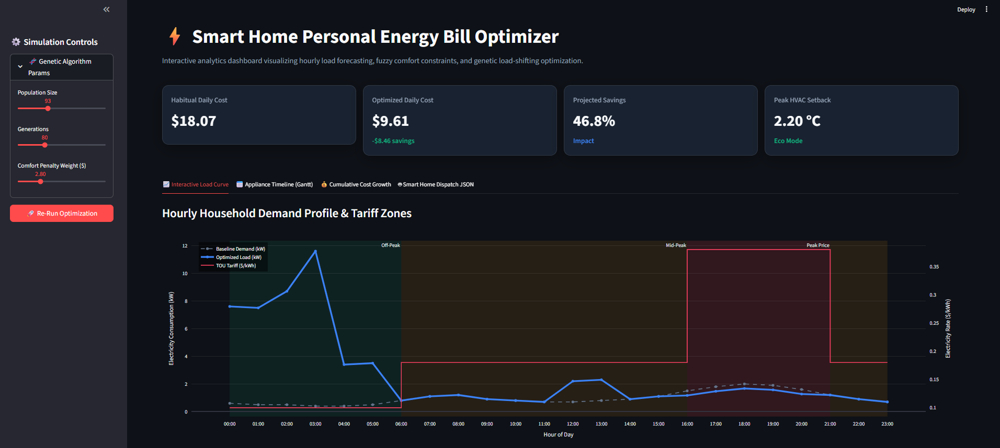

<div align="center">
  
# ⚡ Smart Home Personal Energy Bill Optimizer

[](https://python.org)
[](https://pytorch.org)
[](https://streamlit.io)

An AI-powered energy management system that minimizes household electricity bills by intelligently shifting appliance loads away from peak tariff hours, all while strictly minimizing human discomfort.

</div>

<br>



## 📖 Overview

As time-of-use (TOU) electricity pricing becomes more prevalent, running heavy appliances during peak hours can drastically inflate your energy bill. The **Smart Home Energy Optimizer** acts as an intelligent orchestrator for your home. It predicts your baseline energy demand, evaluates TOU tariffs, and uses a Genetic Algorithm (GA) coupled with a Fuzzy Logic comfort evaluator to reschedule flexible appliances (like EV Chargers and Dishwashers) to off-peak hours.

The result is a fully optimized 24-hour dispatch schedule that guarantees maximum financial savings without compromising your daily routines.

## ✨ Key Features

- **🧠 Neural Network Load Forecasting**: A PyTorch-based Multi-Layer Perceptron (MLP) trained on historical household usage to predict the next 24-hour baseline electrical demand.
- **🧬 Genetic Algorithm (GA) Scheduler**: A custom optimization engine that explores thousands of scheduling combinations to find the absolute best runtimes for high-power appliances.
- **🌡️ Fuzzy Logic Comfort Evaluator**: Translates human discomfort (e.g., waiting 4 hours for laundry, or a 2°C temperature deviation) into a mathematical penalty score, ensuring the GA doesn't sacrifice comfort for cheap energy.
- **📊 Interactive Analytics Dashboard**: A sleek, responsive Streamlit dashboard featuring glassmorphism UI, Plotly dual-axis load curves, and Gantt charts for comparing habitual vs. optimized schedules.
- **🔌 IoT Dispatch Ready**: Generates a standardized JSON payload ready to be ingested by smart home hubs (like Home Assistant) or MQTT brokers to physically actuate smart plugs and HVAC thermostats.

## 🗂️ Project Architecture

```text
energy_optimizer/
│
├── data/
│   └── generate_dataset.py      # Synthetic historical TOU and load data generator
│
├── models/
│   ├── forecasting.py           # PyTorch MLP for baseline load prediction
│   └── fuzzy_comfort.py         # Fuzzy Inference System for comfort penalty evaluation
│
├── optimizer/
│   └── ga_scheduler.py          # Genetic Algorithm for appliance load-shifting
│
├── dashboard.py                 # Interactive Streamlit analytics frontend
├── main.py                      # Headless optimization pipeline script
└── requirements.txt             # Python dependencies
```

## 🚀 Installation & Setup

1. **Clone the repository** (or navigate to the project directory):
   ```bash
   cd energy_optimizer
   ```

2. **Install the dependencies**:
   It is recommended to use a virtual environment.
   ```bash
   pip install -r requirements.txt
   ```

3. **Run the Interactive Dashboard**:
   Launch the Streamlit UI to visualize the load curves and tweak optimization parameters.
   ```bash
   streamlit run dashboard.py
   ```
   Navigate to `http://localhost:8501` in your browser.

4. **Run the Headless Pipeline**:
   If you just want to generate the JSON dispatch payload for your smart home:
   ```bash
   python main.py
   ```

## 🛠️ Usage & Configuration

- **Genetic Algorithm Params**: Tweak the Population Size, Generations, and Comfort Penalty Weight directly via the Streamlit dashboard sidebar to see how they impact the resulting schedule.
- **Appliances**: You can modify the list of flexible appliances (Duration, Power Rating in kW, Preferred Start Hour) inside `optimizer/ga_scheduler.py`.
- **Fuzzy Rules**: The tolerance for temperature drift and appliance delay can be adjusted in `models/fuzzy_comfort.py` to match personal preferences.

## 🔮 Future Enhancements
- [ ] Connect to live weather APIs (e.g., Open-Meteo) for real-time ambient temperature forecasting.
- [ ] Integrate a Multi-Objective Optimizer (NSGA-II) to generate a Pareto front of Cost vs. Discomfort.
- [ ] Add direct MQTT integration to push the JSON payload directly to a Home Assistant server.
