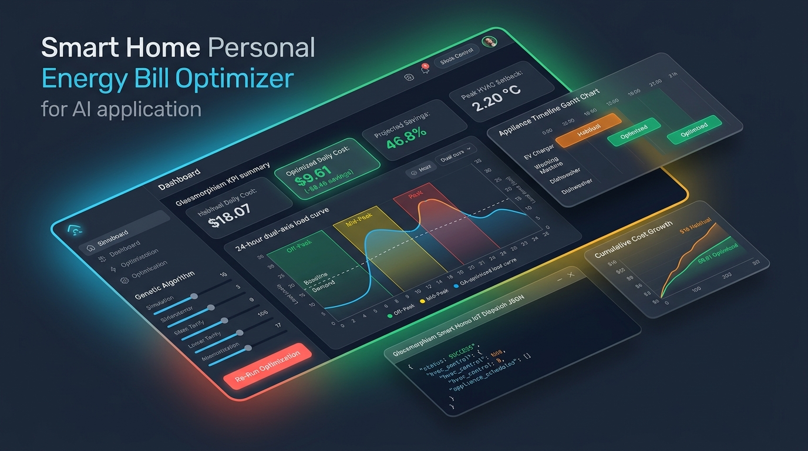

# Smart Home Personal Energy Bill Optimizer

[](https://python.org)
[](https://pytorch.org)
[](https://streamlit.io)
[](https://plotly.com)
[](LICENSE)

An intelligent energy management and demand-response system that minimizes residential electricity costs under Time-of-Use (TOU) tariffs. The system predicts 24-hour baseline household electricity demand with a PyTorch neural network, models occupant convenience using a Fuzzy Inference System (FIS), and executes load-shifting optimization via a Genetic Algorithm (GA) to generate dispatch schedules for IoT smart home hubs.

---

## System Architecture

```text
energy_optimizer/
│
├── data/
│   └── generate_dataset.py      # Synthetic historical TOU rates and demand profiles
│
├── models/
│   ├── forecasting.py           # PyTorch MLP for 24-hour baseline load forecasting
│   └── fuzzy_comfort.py         # Fuzzy Inference System for comfort penalty evaluation
│
├── optimizer/
│   └── ga_scheduler.py          # Genetic Algorithm for appliance load-shifting & HVAC setback
│
├── dashboard.py                 # Interactive Streamlit analytics frontend
├── main.py                      # Headless pipeline and IoT JSON dispatch script
├── requirements.txt             # Project dependencies
├── banner.png                   # System showcase banner and UI mockup
└── README.md                    # Project documentation
```

---

## Core Engineering Modules

### 1. Neural Network Load Forecaster (`models/forecasting.py`)
- **Model Architecture**: Multi-Layer Perceptron (MLP) built in PyTorch with ReLU activations and Dropout regularization.
- **Feature Engineering**: Generates temporal features (hour, day of week), cyclical transformations, environmental variables (ambient temperature, home occupancy), and auto-regressive lag features (`lag_1h`, `lag_24h`, `temp_diff_1h`).
- **Prediction Horizon**: Produces a standardized 24-hour hourly baseline power demand curve (kW).

### 2. Fuzzy Logic Comfort Evaluator (`models/fuzzy_comfort.py`)
- **Appliance Shift Discomfort**: Evaluates delay intervals using triangular and trapezoidal membership functions (`Zero`, `Acceptable`, `Moderate`, `Severe`), converting rescheduling offsets into scaled penalty scores.
- **HVAC Setback Discomfort**: Translates indoor temperature drift deviations during peak hours into human discomfort metrics.
- **Combined Evaluation**: Ensures the optimizer avoids aggressive cost reductions that degrade user convenience.

### 3. Genetic Algorithm Scheduler (`optimizer/ga_scheduler.py`)
- **Chromosome Representation**: Integer-encoded start hours for flexible appliances (EV Charger, Washing Machine, Dishwasher, Heat Pump Dryer) alongside a continuous float gene for peak HVAC temperature setback.
- **Multi-Objective Cost Function**:
  $$\text{Fitness} = \text{Electricity Cost (\$) } + \alpha \cdot \text{Discomfort Penalty}$$
- **Evolutionary Operators**: Tournament selection, uniform crossover with gene-boundary validation, and Gaussian/random reset mutations over configurable generations and population sizes.

### 4. Interactive Glassmorphic Analytics Dashboard (`dashboard.py`)
- **KPI Summary Telemetry**: Real-time glassmorphism metric cards displaying Habitual Cost, GA-Optimized Cost, Projected Savings Percentage, and Peak HVAC Setback.
- **Interactive Load Curves**: Dual-axis Plotly visualization overlaying TOU pricing tiers (Off-Peak, Mid-Peak, Peak Price zones) with baseline and optimized consumption profiles.
- **Appliance Schedule Timeline (Gantt)**: Interactive task shift timeline comparing habitual runtimes against GA-optimized dispatch windows.
- **Cumulative Spending Trajectory**: 24-hour cumulative expenditure growth curves.
- **Simulation Control Panel**: Dynamic sidebar controls to adjust population size, generation limits, and discomfort penalty weights on the fly.

### 5. Smart Home IoT Dispatch Generator (`main.py`)
- Formats optimized schedules into standardized JSON payloads ready for automated ingestion by Home Assistant, MQTT brokers, or smart plug relays.

```json
{
  "status": "SUCCESS",
  "summary": {
    "unoptimized_cost_usd": 18.07,
    "optimized_cost_usd": 9.61,
    "savings_usd": 8.46,
    "savings_percent": 46.8
  },
  "hvac_control": {
    "mode": "PEAK_SAVINGS",
    "peak_setback_celsius": 2.20,
    "effective_hours": "16:00 - 21:00"
  },
  "appliance_schedules": [
    {
      "appliance_name": "EV Charger",
      "power_rating_kw": 3.3,
      "scheduled_start_time": "01:00",
      "scheduled_end_time": "05:00",
      "smart_plug_command": "TURN_ON"
    },
    {
      "appliance_name": "Washing Machine",
      "power_rating_kw": 1.2,
      "scheduled_start_time": "03:00",
      "scheduled_end_time": "05:00",
      "smart_plug_command": "TURN_ON"
    },
    {
      "appliance_name": "Dishwasher",
      "power_rating_kw": 1.5,
      "scheduled_start_time": "00:00",
      "scheduled_end_time": "02:00",
      "smart_plug_command": "TURN_ON"
    },
    {
      "appliance_name": "Heat Pump Dryer",
      "power_rating_kw": 1.0,
      "scheduled_start_time": "02:00",
      "scheduled_end_time": "04:00",
      "smart_plug_command": "TURN_ON"
    }
  ]
}
```

---

## Technical Specifications

| Component | Implementation | Primary Libraries |
| :--- | :--- | :--- |
| **Forecasting Engine** | PyTorch Multi-Layer Perceptron (MLP) | `torch`, `scikit-learn`, `numpy` |
| **Comfort Modeling** | Mamdani-style Fuzzy Inference System | `scikit-fuzzy`, `numpy` |
| **Optimization Engine** | Custom Genetic Algorithm with Elitism | `numpy`, Python Standard Library |
| **Frontend UI** | Dark Mode Glassmorphism Dashboard | `streamlit`, `plotly`, `pandas` |
| **Data Ingestion** | Synthetic TOU and Household Sensor Generator | `pandas`, `numpy` |

---

## Getting Started

### Prerequisites
- Python 3.8 or higher
- pip package manager

### 1. Clone the Repository
```bash
git clone https://github.com/avishka-hashara/Personal-Energy-Bill-Optimizer.git
cd Personal-Energy-Bill-Optimizer
```

### 2. Install Dependencies
```bash
pip install -r requirements.txt
```

### 3. Run the Interactive Dashboard
```bash
streamlit run dashboard.py
```
Open your browser and navigate to `http://localhost:8501`.

### 4. Run the Headless Pipeline
To execute the neural network training, genetic algorithm scheduler, and produce the smart home dispatch payload directly in your terminal:
```bash
python main.py
```

---

## Configuration & Hyperparameters

- **Genetic Algorithm**: Adjust population size, generation limits, and the discomfort penalty weight parameter in `optimizer/ga_scheduler.py` or via the interactive dashboard sidebar.
- **Appliances Profile**: Define flexible appliances, duration cycles, power consumption ratings (kW), and preferred operational windows in `optimizer/ga_scheduler.py`.
- **Fuzzy Boundaries**: Customize tolerance thresholds for schedule delay and temperature drift in `models/fuzzy_comfort.py`.
